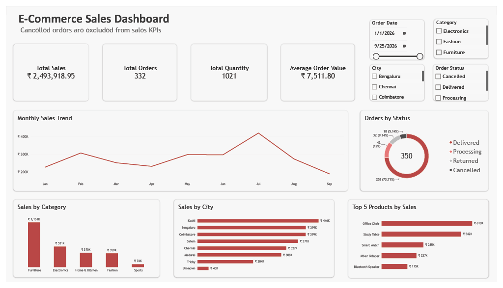

# E-Commerce Sales Dashboard

**Tools:** Power BI, Excel, Data Visualization, DAX

> Task project provided by **Cybexel Technologies Pvt Ltd**

## Overview
An interactive Power BI dashboard built from 350 e-commerce order records (January to September 2026). It tracks sales performance across 7 cities, 5 product categories and 12 products. Cancelled orders are excluded from all sales KPIs.

## Key Metrics (excluding cancelled orders)
| KPI | Value |
|---|---|
| Total Sales | ~2.49M |
| Total Orders | 332 |
| Total Quantity Sold | 1,021 |
| Average Order Value | ~7,512 |

## Key Insights
- **Kochi** is the top-performing city (~446K), followed by Bengaluru (~399K) and Coimbatore (~399K).
- **Furniture** is the top category (~1.16M), contributing about 47% of total sales.
- **Office Chair** is the best-selling product (~618K), followed by Study Table (~542K).
- **July 2026** was the peak sales month (~420K).
- 258 of 350 orders were delivered; 32 were returned and 18 were cancelled.

## Dashboard Features
- KPI cards: Total Sales, Total Orders, Total Quantity, Average Order Value
- Line chart: monthly sales trend
- Column chart: sales by category
- Bar charts: sales by city and sales by product
- Donut chart: order count by order status
- Slicers: Order Date, Category, City, Order Status

## Data Preparation
- Cleaned the raw order data in Excel (no missing values, 350 unique Order IDs).
- Added an **Include in Sales** flag so cancelled orders (18) are excluded from KPIs.
- Handled unknown city values (5 records labelled "Unknown").
- Created measures (Total Sales, Total Orders, Total Quantity, Average Order Value) and a Month field for trend analysis.

## Dataset Columns
Order ID, Order Date, Customer Name, City, Product, Category, Quantity, Unit Price, Discount, Sales Amount, Order Status, Include in Sales

## Files
| File | Description |
|---|---|
| `Sales_Dashboard.pbix` | Power BI dashboard (open with Power BI Desktop) |
| `Task_Data_Clean.xlsx` | Cleaned source data |

## How to Use
1. Download or clone this repository.
2. Open `Sales_Dashboard.pbix` in Power BI Desktop.
3. If prompted, point the data source to `Task_Data_Clean.xlsx`.
4. Use the slicers to filter by date, category, city and order status.

## Dashboard Preview

## Author
**Jeevaneshwaran G**
